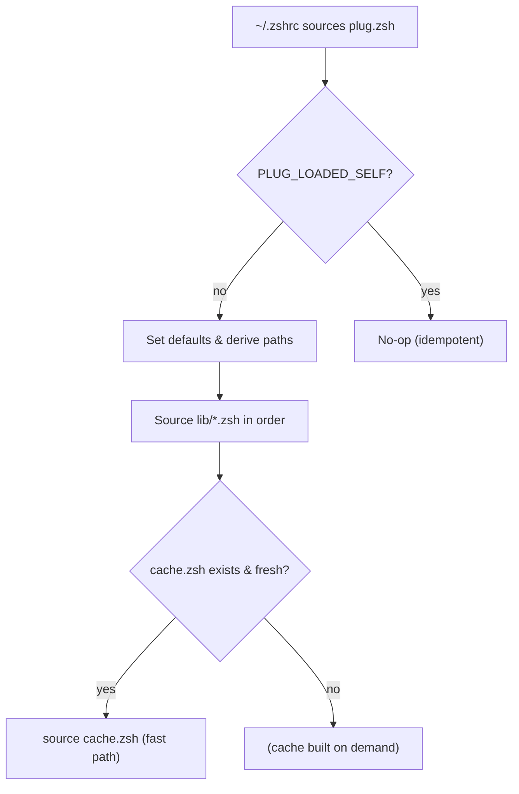
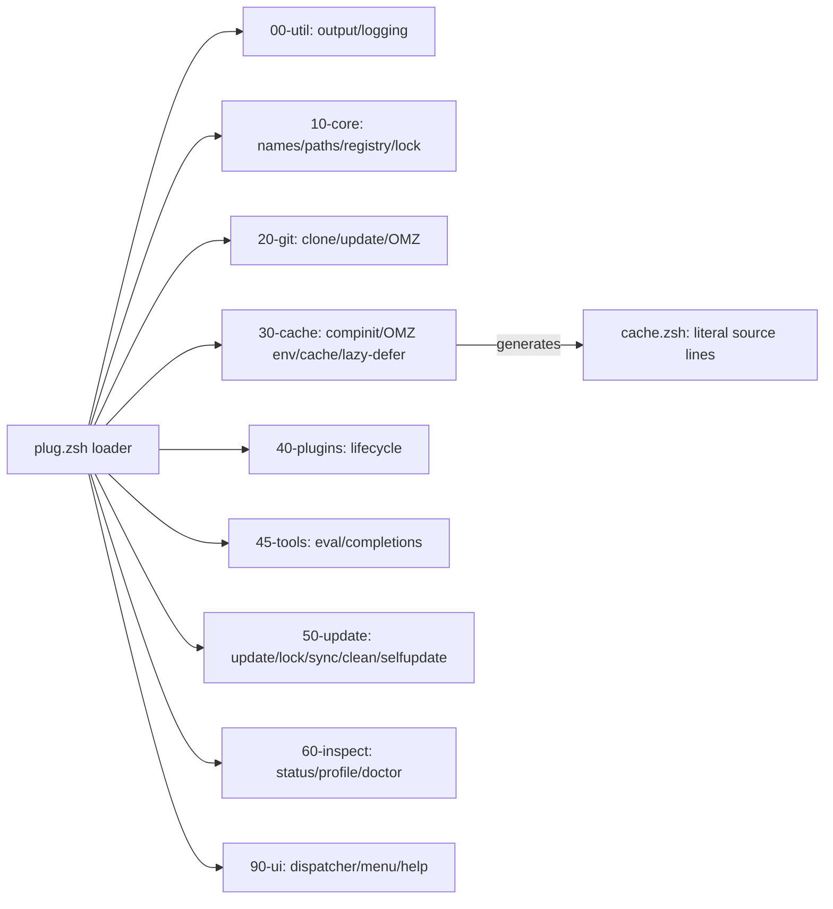

<div align="center">

# plug.zsh

**A fast, modular, and beautiful Zsh plugin manager powered by [Gum](https://github.com/charmbracelet/gum).**

Install GitHub plugins, Oh My Zsh plugins, and your own local files with minimal shell startup overhead. Features lazy & turbo (deferred) loading, parallel updates, reproducible lockfiles, startup profiling, and a single-line startup cache.

[](#)
[](LICENSE)
[](#requirements)
[](#requirements)

[Quick Start](#quick-start) ·
[Installation](#installation) ·
[Usage](#usage) ·
[Architecture](#architecture) ·
[Docs](docs/index.md) ·
[Contributing](#contributing) ·
[Testing](#testing)

</div>

---

## Why plug.zsh?

`plug.zsh` is built for speed and clarity. During shell startup, the hot path does only a few `-nt` checks and a **single literal `source`** of the generated cache — no parsing, no `git`, no `gum`, no subprocesses, and no globbing of plugin files. Management commands are interactive and elegant via Gum, yet your shell starts perfectly without it.



---

## Features

- **GitHub Plugins** — `plug install user/repo` with optional `@branch` pinning.
- **Oh My Zsh Plugins** — `plug install omz <plugin...>`. The `omz` shorthand works anywhere in args.
- **Local Files/Dirs** — `plug add ~/aliases.zsh` sources a file; `plug add ~/lib/` adds to `fpath` and sources `*.zsh`.
- **Lazy Loading** — Load on first command use: `plug lazy <plugin> <cmd1> <cmd2>...`
- **Turbo/Deferred Loading** — Load after first prompt with delay (ms): `plug defer <plugin> <delay>`
- **Parallel Updates** — `plug update` fetches with configurable `PLUG_JOBS` (default 4).
- **Reproducible Lockfiles** — `plug lock` records exact commits; `plug sync` restores them.
- **Cached Tool Inits** — `plug eval add <tool> '<cmd>'` caches init output and sources it.
- **Managed Completions** — `plug completion add <file>` or `plug completion gen <cmd> '<gen-cmd>'`.
- **Health & Profiling** — `plug status`, `plug doctor`, `plug profile`, `plug info`, `plug logs`.
- **Offline & Sandboxable** — Fully testable without network access or touching real `$HOME`.
- **Graceful UX** — TTY gets colors/icons; piped/non-TTY gets plain tab-separated output; Gum optional.

---

## Requirements

- **zsh** 5.3+ (Linux/macOS)
- **git** (2.25+ recommended for OMZ sparse checkout)
- **[gum](https://github.com/charmbracelet/gum)** — required only for management commands (shell starts without it)
- **Nerd Font** (optional) for icons

---

## Installation

### Recommended: Auto-install (no manual clone needed)

Add this to your `~/.zshrc` **before** any `compinit`:

```zsh
PLUG_HOME="${XDG_DATA_HOME:-${HOME}/.local/share}/plug/plug.git"
if [[ ! -d "$PLUG_HOME" ]]; then
    git clone --depth=1 https://github.com/Armoghan-ul-Mohmin/plug.git "$PLUG_HOME"
fi
source "$PLUG_HOME/plug.zsh"
```

Reload your shell:

```zsh
exec zsh
plug doctor
```

This automatically clones plug.zsh if missing and keeps `lib/` next to `plug.zsh`. Sourcing twice is a safe no-op (`PLUG_LOADED_SELF` guard). For manual/package manager options, see [docs/installing.md](docs/installing.md).

---


## Quick Start

```zsh
# Install GitHub plugins
plug install zsh-users/zsh-autosuggestions zsh-users/zsh-syntax-highlighting

# Pin a specific branch
plug install zdharma-continuum/fast-syntax-highlighting@master

# Install Oh My Zsh plugins (omz can appear anywhere)
plug install omz git docker sudo
plug install user/foo omz fzf-tab

# Lazy load when a command is first used
plug lazy Aloxaf/fzf-tab fzf

# Defer loading after first prompt (~500ms)
plug defer zsh-users/zsh-autosuggestions 500

# Check status
plug status
```

Apply changes with `exec zsh` after adding lazy/defer/eval/completions.

---

## Usage

### Core Commands
```zsh
plug list                # List plugins (tab-separated when piped)
plug status              # Dashboard with states, commits, cache, lock drift
plug install <args>      # Install GH/OMZ plugins; omz shorthand supported
plug add <path>          # Source file or add dir to fpath + source *.zsh
plug remove <name>       # Remove plugin (safe; add'd files/dirs not auto-removed)
plug enable/disable      # Toggle plugins
plug lazy <plug> <cmds>  # Lazy-load on first command use
plug defer <plug> <ms>   # Turbo/deferred load after first prompt
plug source <plug>       # Force source a plugin
plug update              # Parallel update (PLUG_JOBS)
plug outdated            # Show plugins with upstream changes
plug lock                # Record exact commits
plug sync                # Restore from lockfile
plug reload              # Rebuild cache & reload
plug doctor              # Health check
plug profile             # Startup timing
plug help                # Built-in help
plug menu                # Interactive Gum menu
plug browse              # Curated catalog
plug omz                 # Browse OMZ checkout
```

### Tools & Completions
```zsh
plug eval add zoxide 'zoxide init zsh'
plug eval list/remove/refresh
plug completion add ./_mytool
plug completion gen kubectl 'kubectl completion zsh'
plug completion list/remove
```

Full reference: [docs/commands.md](docs/commands.md), [PLUG.md](PLUG.md).

---

## Architecture

plug.zsh is modular and cache-driven for minimal startup cost.



- **Startup fast path:** only `-nt` checks + single `source cache.zsh`. No git/gum/parsing/globbing.
- **Public on-disk state:** `plugins.txt`, `disabled.txt`, `lazy.txt`, `deferred.txt`, `branches.txt`, `evals.txt`, `lock` (`name|branch|commit`), `cache.zsh` under `PLUG_DIR`.
- **Idempotent:** guarded by `PLUG_LOADED_SELF`; `PLUG_DIR` preserved if exported.
- **Details:** [docs/architecture.md](docs/architecture.md), [docs/configuration.md](docs/configuration.md).

---

## Development


**Key conventions:**
- Pure Zsh, 4 spaces, no tabs, `name() { }` (no `function`), prefer `${…}`, `emulate -L zsh` for stateful; comments explain *why*.
- `GIT_TERMINAL_PROMPT=0` for all git ops; no secrets logged.
- Destructive commands confirm unless `-y/--yes`.
- Only `list|ls|--version|-v|version|help|h|info|about` work without gum.

See [CONTRIBUTING.md](CONTRIBUTING.md) for full dev setup, style, and adding tests.

---

## Testing

Tests run **entirely offline** in an isolated sandbox (local bare git remotes + fake OMZ; isolated `$HOME`/`ZDOTDIR`).

```zsh
# Run all tests
zsh test/run-tests.zsh

# List cases
zsh test/run-tests.zsh --list

# Filter by name/number
zsh test/run-tests.zsh install lazy
```

- 17 ordered, stateful cases covering all features.
- Must pass: **96 passed, 0 failed**.
- Syntax check: `for f in plug.zsh lib/*.zsh test/run-tests.zsh test/lib/*.zsh test/cases/*.zsh; do zsh -n "$f" || exit 1; done`
- YAML check: `python3 -c 'import yaml,glob; [yaml.safe_load(open(p)) for p in glob.glob(".github/**/*.yml",recursive=True)]'`

CI runs on Linux/macOS. See [test/README.md](test/README.md).

---

## Docs

| Doc | Purpose |
|---|---|
| [PLUG.md](PLUG.md) | Complete manual (commands, settings, internals) |
| [docs/index.md](docs/index.md) | Documentation TOC |
| [docs/installing.md](docs/installing.md) | Install/upgrade/first run |
| [docs/commands.md](docs/commands.md) | Full command reference with examples |
| [docs/configuration.md](docs/configuration.md) | All PLUG_* variables |
| [docs/architecture.md](docs/architecture.md) | Modules, cache, lazy/defer |
| [docs/migration.md](docs/migration.md) | Migrate from OMZ/zinit/znap/antigen/antibody |
| [docs/comparison.md](docs/comparison.md) | Feature comparison |
| [docs/troubleshooting.md](docs/troubleshooting.md) | Troubleshooting guide |
| [docs/faq.md](docs/faq.md) | FAQs |
| [docs/history.md](docs/history.md) | History & AI disclosure |

---

## History & AI Disclosure

This is **plug.zsh v1.0.1** (second generation, first public line is v1.0.0). The first single-file version was never finished/published; this rewrite was developed with **heavy AI assistance**, then reviewed and end-to-end tested. Every command is covered by the sandboxed test suite to ensure correctness. See [docs/history.md](docs/history.md) for the full story.

---

## Contributing

Bug reports, features, and PRs welcome. Before opening a PR:
1. `zsh -n` on changed files
2. `zsh test/run-tests.zsh` — must pass (96/0)
3. Follow style (4 spaces, `name() { }`, explain *why*, no secrets)

See [CONTRIBUTING.md](CONTRIBUTING.md).

## License

[MIT](LICENSE) © 2026 Armoghan-ul-Mohmin
